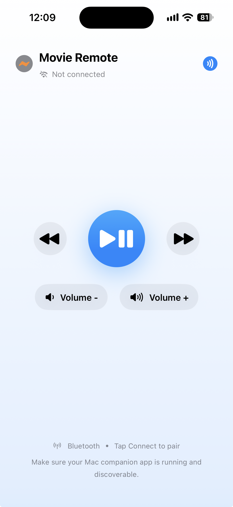
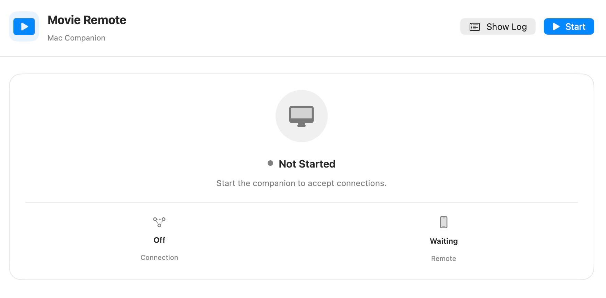

# Movie Remote

I enjoyed watching movies on my mac. But I sit too far away from it and I don't want to bring keyboard to me. It's tiring to stand up, walk, and press spacebar to pause.

A motto of being a developer is working an hour to solve 2s of my everyday problem. This project is one of them.

A simple iOS app that works as pause, forward, backward, volume down, and volume up just like a TV remote.

A simple mac companion to realy command from iOS app.

I really enjoyed working on this project.
